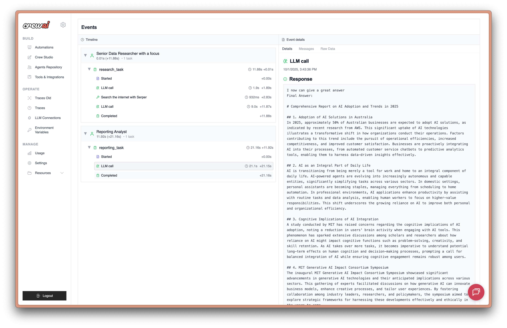

# GPT Image by Ace Data Cloud：CrewAI 独立原生工具

由 **Ace Data Cloud** 提供，不是 GPT Image 或 CrewAI 官方产品。独立品牌工具包，不是通用服务合集。[English](../README.md)

## 安装

已有[GitHub预览wheel/sdist](https://github.com/AceDataCloud/GPTImageCrewAI/releases/tag/v0.1.0-preview.1)，源码仍在审阅；尚未PyPI发布、尚未进入CrewAI官方Tools/AMP目录。先检查[源码PR](https://github.com/AceDataCloud/GPTImageCrewAI/pulls)，用审阅后的固定完整SHA安装，不把仓库或本地导入当官方收录：

```bash
uv add 'crewai-gpt-image @ git+https://github.com/AceDataCloud/GPTImageCrewAI.git@c39dcdb493a5f96fc53f05f5d4cfa4f081e740f5'
```

正式PyPI发布后目标为 `uv add crewai-gpt-image`，目前不要假设可用。Python3.10–3.13；Intel macOS可能缺CrewAI强制依赖lancedb wheel，正式使用选择受支持Linux，不跳依赖伪装正常安装。


```bash
uv add 'crewai-gpt-image @ https://github.com/AceDataCloud/GPTImageCrewAI/releases/download/v0.1.0-preview.1/crewai_gpt_image-0.1.0-py3-none-any.whl#sha256=58c3dca3cca31d3243e365dfe42486aeac49d6e61aff7053d50a9b27c90c5619'
```

历史preview.1 wheel来自原源码ec567ac75a2b8d0a21cbd3916eafe9b84430f9ad，上方推荐源码为含终态修复的新SHAc39dcdb493a5f96fc53f05f5d4cfa4f081e740f5，二者分别记录，URL强制SHA256校验；若附件被替换必须摘要失败。release页面/tag仅提供信息，不作信任锚。

## 注册登录、General application和专用Token

1. 打开 [Ace Applications](https://platform.acedata.cloud/console/applications?utm_source=github&utm_medium=referral&utm_campaign=evergreen&utm_content=gptimagecrewai_readme_zh_api_key)，注册并登录。必要时初始化General application。
2. 打开General application，确认GPT Image权限、当前[模型价格和余额](https://platform.acedata.cloud/models?utm_source=github&utm_medium=referral&utm_campaign=evergreen&utm_content=gptimagecrewai_readme_zh_pricing)；服务专属应用只可使用对应授权服务。
3. 点击下图1复制已有Key，或2 **Manage Keys → Create** 创建 `GPT Image CrewAI` 专用Key。


4. 按需设过期、额度限制。Allowed APIs启用时同时允许 `/openai/images/generations`、`/openai/tasks`。


2026-10-18从SunoDify固定SHA `8d3d03570e73324220f111f7fe343da0792a8071` 原样复用。第二图历史名字Dify tutorial只是例子，这里填 `GPT Image CrewAI`；没有可见真实凭据。[来源](../assets/tutorial/source.json)。

将原始API消费者Token安全写入环境变量 `ACEDATACLOUD_API_KEY`，不加Bearer/空格/引号，不用platform管理Token，不写prompt、截图或提交.env。可由密钥存储传入api_key参数，序列化不包含它。

## CrewAI粘贴位置与具名工具

```python
from crewai import Agent
from gpt_image_crewai import GPTImageGenerateImageTool, GPTImageRetrieveTaskTool

agent = Agent(
    role="GPT Image制作助手",
    goal="按已批准额度生成，并查询原任务结果",
    backstory="通过Ace Data Cloud使用GPT Image",
    llm=your_configured_llm,
    tools=[GPTImageGenerateImageTool(), GPTImageRetrieveTaskTool()],
    allow_delegation=False,
    max_retry_limit=0,
)
```

Key放环境变量，工具加入Agent的tools列表，无需MCP。工具名为 **GPT Image by Ace Data Cloud - Generate Image / Retrieve Task**。仅添加不调用；实际付费由使用者批准。每个生成实例默认一次使用，防止重复提交，但不是资金上限/授权系统。

## 服务差异、首用与异步同ID查询

仅GPT Image生成：当前 gpt-image-* 模型、prompt、size（auto或宽x高）、quality、n 1..10、background、output_format/compression、moderation。接口为 /openai/images/generations，固定 response_format=url 和异步查询；不是DallETool、Nano Banana或通用图片provider，首版不含multipart编辑。

[当前目录](https://platform.acedata.cloud/models?utm_source=github&utm_medium=referral&utm_campaign=evergreen&utm_content=gptimagecrewai_readme_zh_first_use)决定可用模型/组合和价格，模型ID原样传递，不自动fallback。下面是固定合同的示例，不是永久默认；**真实执行生成收费，本教程未执行**：

```python
import json
from gpt_image_crewai import GPTImageGenerateImageTool, GPTImageRetrieveTaskTool

parameters = {
    "model": "gpt-image-2",
    "prompt": "A red apple on a plain white background",
    "size": "1024x1024",
    "quality": "low",
    "n": 1
}
# 执行会收费，须先批准模型和额度。
submitted = GPTImageGenerateImageTool().run(**parameters)
submitted = json.loads(submitted)  # 先处理可能的ToolFailure，不能直接当成功。
result = GPTImageRetrieveTaskTool().run(task_id=submitted["task_id"], wait_seconds=240)
print(result)
```

生成只提交一次async=true，accepted/pending不是成功，即使外层success=true也不例外。保存原task_id，未完成/超时/结果不明时先查历史，不重新生成。等待只查询同一ID，有界等待还可能包含在途请求的超时。终态必须有finished_at、服务success及目标媒体URL；嵌套失败和终态缺媒体不当成功。

查询自己已有任务的免费例子：

```bash
uv run python examples/query_existing.py YOUR_EXISTING_TASK_ID
```

实际查询 `POST /openai/tasks`、action=retrieve、id=原ID；输出status/success/task_id/media_urls/原cost（Credits，不是USD或新账单）。不返回原prompt/请求、账户应用身份或原始诊断；URL存在不代表已验证长期可播放。

## 查看工具执行



[官方tracing参考](https://docs.crewai.com/en/observability/tracing)，2026-10-18取回，图中10/1/2025日期标记、版本未注明。左为执行步骤，右只展开Response；**非本包运行、非Ace调用、不承诺新GUI**。可选trace账号/认证/同意须由用户依官方规则完成，本包不启用。真实截图不要泄露Key/私人媒体。

## 常见问题

| 情况 | 处理 |
|---|---|
| 401/403 | 检查完整消费者Token、过期、服务授权、Allowed APIs与余额；403不一概等于审核。 |
| 400/本地schema失败 | 用本服务的字段、大小写及模型组合；错误跨服务字段联网前拒绝。 |
| pending/无结果 | 只查询原ID，不重新生成。 |
| 429 | 降并发等待；工具HTTP不自动重试，LLM/agent本身可能另有重试。 |
| 超时/5xx | 提交可能已到服务端，先查历史再决定是否重发。 |
| ToolFailure | 失败或终态缺正确媒体，结构化默认不可重试；联系支持用task/trace ID，别交Key。 |
| 媒体打不开 | 核终态与网络；不把URL存在当播放验收。 |

代码免费，媒体与配置的LLM按当前价格计费；无支付处理器/自动收费重试/fallback。原Credits费用按当前应用套餐折扣，不硬编码旧美元换算。不把安装/测试数当注册或收入。prompt/参考素材与Token仅发往api.acedata.cloud；本包无追踪，CrewAI/LLM设置另算。[隐私](../PRIVACY.md) · [源码](https://github.com/AceDataCloud/GPTImageCrewAI) · [反馈](https://github.com/AceDataCloud/GPTImageCrewAI/issues) · dev@acedata.cloud

开发：uv sync --group dev；uv run pytest；uv run ruff check .；uv build。测试Mock收费HTTP，真实Agent/Task/Crew使用本地确定性模型，不冒充真实AI决策。合同固定来源见tests/contract-source.json。

最新固定源码已修正finished_at写入前的明确失败判断；旧preview.1作为历史不变附件保留，建议用当前固定源码取得修复。
